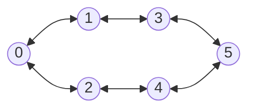

# 1. Grafos y algoritmos de recorrido

a. Para este escenario elegimos una red de transporte. Será modelado utilizando
un grafo ponderado y dirigido:

- Nodos: representarán las estaciones (paradas de colectivos, estaciones de 
  subte) o intersecciones entre calles.
- Aristas: representan las calles o tramos de vías férreas que conectan las
  estaciones y las intersecciones.
- Grafo dirigido: ya que una calle puede tener un sentido único o sentido doble,
  un grafo dirigido es ideal para este modelo.
- Grafo ponderado: para calcular las rutas óptimas, cada arista debe tener un 
  valor asociado (peso o costo) que represente la distancia o el tiempo de viaje
  entre las estaciones.

---

b. El recorrido BFS permite explorar los nodos nivel por nivel, lo que garantiza
que el primer camino identificado hacia un nodo sea el más corto en cuanto a 
cantidad de aristas. Este algoritmo sería útil para encontrar la ruta más corta 
entre dos estaciones, o para detectar si todas las estaciones están conectadas.

Hay que tener en cuenta que ni BFS ni DFS son óptimos para
grafos ponderados como el nuestro.

La implementación de BFS se encuentra en `parte1ejercicio1b.cpp`. El grafo de 
nuestro sistema se vería así:

# 2. Árboles B y su aplicación

# 3. Montículos binarios y heap sort