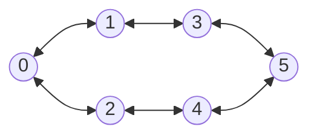

# 1. Grafos y algoritmos de recorrido

a. Para este escenario elegimos una red de transporte. Será modelado utilizando
un grafo ponderado y dirigido:

- Nodos: representarán las estaciones (paradas de colectivos, estaciones de 
  subte) o intersecciones entre calles.
- Aristas: representan las calles o tramos de vías férreas que conectan las
  estaciones y las intersecciones.
- Grafo dirigido: ya que una calle puede tener un sentido único o sentido doble,
  un grafo dirigido es ideal para este modelo.
- Grafo ponderado: para calcular las rutas óptimas, cada arista debe tener un 
  valor asociado (peso o costo) que represente la distancia o el tiempo de viaje
  entre las estaciones.

---

b. El recorrido BFS permite explorar los nodos nivel por nivel, lo que garantiza
que el primer camino identificado hacia un nodo sea el más corto en cuanto a 
cantidad de aristas. Este algoritmo sería útil para encontrar la ruta más corta 
entre dos estaciones, o para detectar si todas las estaciones están conectadas.

Hay que tener en cuenta que ni BFS ni DFS son óptimos para
grafos ponderados como el nuestro.

La implementación de BFS se encuentra en `parte1ejercicio1b.cpp`. El grafo de 
nuestro sistema se vería así:



---

c. Se le pasó el siguiente prompt a GPT-6 Luna:

> Tengo el siguiente algoritmo BFS en C++:
> `parte1ejercicio1b.cpp` 
> Si es posible, optimizalo. De no ser posible una optimización, realizá una 
> variación del mismo

La respuesta de la IA fue la siguiente:

> El BFS ya tiene complejidad óptima para recorrer el grafo: **\(O(V+E)\)**, 
> donde \(V\) es el número de estaciones y \(E\) el número de conexiones. Sí se 
> puede mejorar su diseño: pasar el grafo como referencia constante, obtener la 
> cantidad de nodos directamente del vector y separar el recorrido de la 
> impresión. Esta variación devuelve el orden de visita:
> 
> ```cpp
> #include <iostream>
> #include <queue>
> #include <vector>
> 
> std::vector<int> BFS(const std::vector<std::vector<int>>& grafo, int inicio) {
>     if (inicio < 0 || inicio >= static_cast<int>(grafo.size())) {
>         return {}; // Inicio inválido
>     }
> 
>     std::vector<bool> visitado(grafo.size(), false);
>     std::queue<int> cola;
>     std::vector<int> recorrido;
> 
>     visitado[inicio] = true;
>     cola.push(inicio);
> 
>     while (!cola.empty()) {
>         int nodo = cola.front();
>         cola.pop();
>         recorrido.push_back(nodo);
> 
>         for (int vecino : grafo[nodo]) {
>             if (!visitado[vecino]) {
>                 visitado[vecino] = true;
>                 cola.push(vecino);
>             }
>         }
>     }
> 
>     return recorrido;
> }
> 
> int main() {
>     std::vector<std::vector<int>> grafo(6);
> 
>     grafo[0] = {1, 2};
>     grafo[1] = {0, 3};
>     grafo[2] = {0, 4};
>     grafo[3] = {1, 5};
>     grafo[4] = {2, 5};
>     grafo[5] = {3, 4};
> 
>     for (int estacion : BFS(grafo, 0)) {
>         std::cout << "Visitando estación: " << estacion << '\n';
>     }
> 
>     return 0;
> }
> ```
> 
> Para este grafo, el orden es `0, 1, 2, 3, 4, 5`. El resultado puede variar si 
> cambia el orden de los vecinos en las listas de adyacencia. Esta versión 
> también evita que `BFS` tenga que conocer de antemano el número de nodos.

Si bien el código propuesto por GPT-6 no realiza cambios considerables al 
algoritmo propuesto en términos de eficiencia, sí mejora el código para que sea
más legible, más estable y siguiendo las mejores prácticas de C++.

# 2. Árboles B y su aplicación

a. Un Árbol B es una estructura jerárquica y autobalanceada diseñada para 
minimizar los accesos al disco y mantener los datos ordenados. Es recomendable 
para sistemas de archivos (como el UNIX File System, donde es necesario 
indexar grandes volúmenes de datos) o bases de datos (para crear índices que 
permitan acceder a millones de registros en disco de forma rápida).

---

b. El código en C++ se encuentra en `parte1ejercicio2b.cpp`.

---

c. Se le hizo la siguiente pregunta a GPT-6:

> Cuáles son las ventajas y desventajas de los árboles B frente a otras 
> estructuras de datos?

Y su respuesta fue:

> Los **árboles B** son árboles de búsqueda equilibrados en los que cada nodo 
> puede contener varias claves y tener muchos hijos. Su mayor ventaja aparece 
> cuando los datos están en disco o en almacenamiento externo, porque permiten
> encontrar y actualizar elementos con pocas lecturas.
> 
> | Estructura                      | Ventajas frente a un árbol B                                                          | Desventajas frente a un árbol B                                 |
> |---------------------------------|---------------------------------------------------------------------------------------|-----------------------------------------------------------------|
> | Árbol binario de búsqueda común | Puede ser más sencillo de implementar                                                 | Puede desequilibrarse y degradarse a búsquedas lineales         |
> | Árbol AVL o rojo-negro          | Suele ser más eficiente si los datos caben en memoria y los nodos tienen pocas claves | Tiene más niveles; puede requerir más accesos a disco           |
> | Tabla hash                      | Búsqueda promedio muy rápida por clave exacta                                         | No mantiene los datos ordenados ni facilita consultas por rango |
> | Arreglo ordenado                | Búsqueda rápida y acceso sencillo por índice                                          | Insertar o borrar suele exigir mover muchos elementos           |
> 
> **Ventajas principales:** mantienen el equilibrio, ofrecen búsqueda, 
> inserción y borrado en tiempo \(O(\log n)\), y su gran ramificación reduce la
> altura del árbol. Además, conservan las claves ordenadas, lo que facilita 
> recorrerlas en orden y hacer consultas por intervalos.
> 
> **Desventajas:** su implementación es más compleja que la de estructuras
> simples; las divisiones y fusiones de nodos complican las actualizaciones. 
> En memoria, donde los accesos no son costosos como en disco, un árbol binario
> equilibrado o una tabla hash puede resultar más conveniente. Y aunque un
> árbol B permite recorridos ordenados, para búsquedas exclusivamente por 
> igualdad una tabla hash suele ser más rápida en promedio.
> 
> En resumen: un árbol B suele ser una buena elección para **índices y 
> conjuntos grandes almacenados en disco**; para datos pequeños en memoria o
> búsquedas solo por clave exacta, otras estructuras pueden convenir más.

La respuesta de GPT-6 está bastante completa y correcta. Es cierto que la 
ventaja del Árbol B radica en su capacidad de agrupar muchas claves por nodo 
para minimizar los accesos a disco. También es cierto que su complejidad de 
implementación es mayor, y que el proceso de eliminación es complejo.


# 3. Montículos binarios y heap sort

a. Un montículo binario se utiliza en la implementación de colas de prioridad,
en planificadores de tareas en sistemas operativos (para extraer siempre el
proceso de mayor prioridad en tiempo logarítmico y mantener el orden correcto
tras cada inserción o eliminación), o en algoritmos que requieren una gran 
cantidad de operaciones de decrease-key (como el algoritmo de Dijkstra).

En un heap mínimo, el valor almacenado en cada nodo es menor o igual que el de 
sus hijos, y la raíz contiene el elemento de menor prioridad. Mientras que en
el heap máximo, el valor de cada nodo es mayor o igual que el de sus hijos, y 
la raíz contiene el elemento de mayor prioridad.

b. Para armar un proceso de heap sort, se tomará como arreglo inicial 
`[4, 10, 3, 5, 1]` para ordenarlo de forma ascendente. 

1. Primero se construye el heap máximo `[10, 5, 3, 4, 1]`. 
2. Luego se intercambia la raíz `10` con el último elemento `1`, resultando 
   `[1, 5, 3, 4, 10]`. 
3. Se hace el reajuste para restaurar la propiedad de heap máximo quedando
   `[5, 4, 3, 1, 10]`
4. Se intercambia el `5` con el `1`: `[1, 3, 4, 5, 10]`
5. Se reorganiza: `[4, 1, 3, 5, 10]`
6. Se intercambia el `4` con el `3`: `[3, 1, 4, 5, 10]`
7. Se intercambia el `3` con el `1`: `[1, 3, 4, 5, 10]`